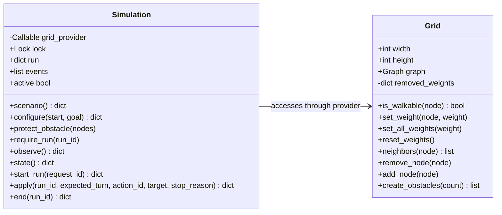
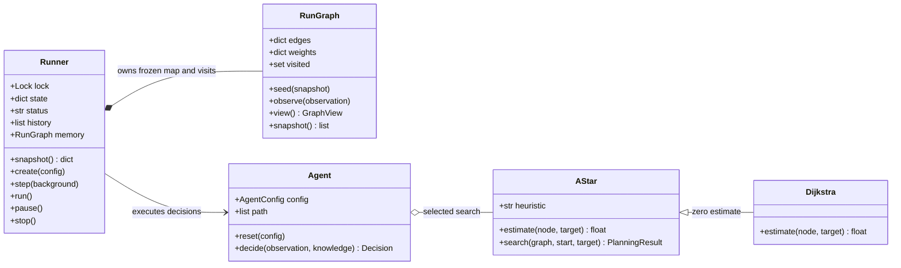

# Class diagrams

These diagrams show the functional classes in the environment and agent. Data
transfer models, exceptions, protocols, and gRPC-generated classes are omitted.

## Environment

`Grid` owns the mutable NetworkX map. `Simulation` accesses the current grid
through a provider so replacing or resizing the grid does not require replacing
the simulation instance.

## Agent

`Runner` controls execution and records each turn. It loads `RunGraph` from the
complete frozen run grid and records physical visits from observations. `Agent`
executes the selected Dijkstra or A* search, then follows its cached route and
stops at the goal without exploration. A* receives the configured heuristic;
Dijkstra reuses the search with zero estimates.
